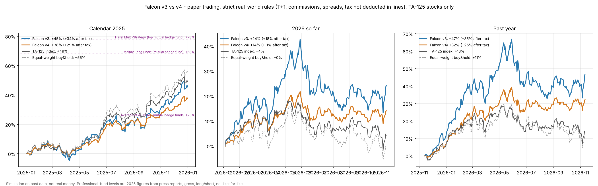

# Falcon: paper-trading models for the TA-125 (research only)

> **Research project, paper trading only.** Nothing here is investment advice, nothing trades real money, and simulated results do not predict future returns.
> The numbers are honest about what did and did not work, including the ways they are optimistic.

**Falcon** ranks TA-125 stocks every day with calibrated gradient-boosting ensembles (a next-day question and a 10-day "beats the median" question, retrained every 21 days on data known at that time),
buys the top-ranked, holds while they stay highly ranked, and exits on an ATR stop. It is replayed on past data with real-world frictions: opening-auction fills, commissions with a minimum,
half-spread (doubled for thin stocks), square-root market impact, a 10%-of-daily-volume cap, whole shares, T+1 settlement of sale proceeds, 4% on idle cash, and 25% tax reported separately.
Only TA-125 stocks are traded (117 had enough history to be scored).

## Results (1,000,000 ILS, strict real-world rules, settings chosen on 2023-24, test periods run once)

| Period | Falcon v3 | Falcon v4 | TA-125 index | Equal-weight buy & hold |
|---|---|---|---|---|
| Calendar 2025 | +45.4% | +37.6% | +49.0% | +55.9% |
| 2026 to 11 Nov | +24.2% | +14.1% | +4.2% | +0.2% |
| Past year (12 Nov 2025 to 11 Nov 2026) | +46.7% | +32.1% | +13.5% | +11.4% |

Maximum drawdown, v3 / v4: 2025 -12.0% / -8.4%; 2026 -20.7% / -10.6%; past year -20.4% / -10.5%. **v4 is calmer, not more profitable.**
For context only (not like-for-like: gross, long/short, may use leverage), press reports give +78% and +68% for the best Israeli mutual hedge funds in 2025 and +25% on average.
**These models did not beat the best funds.**



How to read the numbers: the test periods were run once, but 2025 had been looked at in earlier iterations; the universe is today's index members (survivorship bias, which lowers real results
when tested point-in-time); several candidates were compared, so validation figures are optimistic. Everything that was tried and did not help is in
[`docs/FALCON_V4_RESULTS.md`](docs/FALCON_V4_RESULTS.md) (quarterly reports, large models, market-regime filters, trailing stops, take-profit orders, rule guards, ensembles of recipes,
sector neutralisation, target engineering, Wikipedia attention data).

## Dataset

[`dataset/`](dataset/) holds this project's own outputs: daily model scores for every stock, simulated trade logs, equity curves and the experiment tables. No raw third-party price or
financial data is redistributed; see [`DATA_SOURCES.md`](DATA_SOURCES.md) and [`dataset/README.md`](dataset/README.md).

## Run it

```bash
pip install -e .[dev]
python -m pytest                                              # the test suite
python -m tradingbot falcon select --out runs/falcon --val 2023-01-03,2024-12-31 --recipes cross2r
python -m tradingbot falcon final  --out runs/falcon          # runs the test periods once with the chosen settings
python -m tradingbot fundhist                                 # optional: quarterly reports (public pages, slow, 1 request/second)
```

Training is checkpointed (an interrupted run resumes where it stopped) and takes hours on a laptop. Prices come from Yahoo Finance through `yfinance` and are cached locally.
The simulator (`tradingbot/simulate.py`) and the recipes (`tradingbot/falcon.py`) are the places to start reading; `scripts/` has the validation experiments.

## License

Code: MIT ([`LICENSE`](LICENSE)). Dataset files: CC BY 4.0. Use of the market-data downloaders is subject to each provider's terms.
