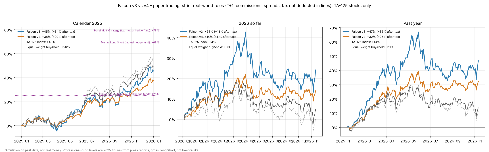

# Falcon v4: what was tried, and the final test

Paper trading only (no broker, no real money). TA-125 stocks only. 1,000,000 ILS, strict real-world rules: opening-auction fills, 0.05% commission with a 7 ILS minimum per order, 0.1% half-spread (doubled for thin stocks), square-root impact, <=10% of average daily value, whole shares, T+1 settlement of sale proceeds, 4% on idle cash, 25% tax reported separately.

## Final test (run once, settings fixed on 2023-24 / 2024 only)

| Period | v3 | v4 | TA-125 index | Equal-weight buy&hold |
|---|---|---|---|---|
| Calendar 2025 | +45.4% (after tax +34.3%) | +37.6% (+28.6%) | +49.0% | +55.9% |
| 2026 to 11 Nov | +24.2% (+18.3%) | +14.1% (+11.0%) | +4.2% | +0.2% |
| Past year | +46.7% (+35.2%) | +32.1% (+24.5%) | +13.5% | +11.4% |

Max drawdown, v3 / v4: 2025 -12.0% / -8.4%; 2026 -20.7% / -10.6%; past year -20.4% / -10.5%.

v4 = recipe `cross2r`, 30 positions, hold while in the top 90, 4-ATR stop, volatility-scaled slices. It is a calmer portfolio, not a more profitable one.

## Against the professionals (2025, not like-for-like: gross, long/short, may use leverage)
Harel Multi-Strategy +78%, Meitav Long Short +68%, average of 46 Israeli mutual hedge funds +25%. v3 and v4 beat the average, not the best funds.

## What did not help (validation 2023-24 / 2024)
Quarterly reports (cross3 0.1018 vs cross2r 0.1091), a large XGBoost (full 0.1061), market-regime filters, trailing stops, fewer positions, take-profit orders, other fill times. Stricter realism cost 4 points in 2024 and 11 in 2025.

## Later experiments (all scored on 2024 validation only, none adopted)
| Idea | Result vs v4 as locked (+28.9%, Sharpe 3.10) |
|---|---|
| Professional chart setups (volatility contraction, volume dry-up/breakout, relative-strength line, trend template), recipe `pro` | rank-IC score 0.1058 vs 0.1091: no gain |
| Rule guards (no-chase, overbought, falling knife, volume, cooldown) | each -0.4 to -4 points; all together -5 points |
| Sector cap of 5 buys per day | +30.6%, Sharpe 3.33: within noise, not adopted |
| Ensembles of recipes (cross, cross2r, pro, cross3) | +22.9% to +28.8%: no gain |
| Sector-neutralising the ranking after prediction (strength 0.25 to 1.0) | +24.9% to +28.4%: no gain |
| Conviction sizing (bigger slices for top ranks) | +36.0% Sharpe 2.81 dd -7.6% vs +28.9% Sharpe 3.10 dd -4.6%: a risk/return trade, not adopted |
| Target engineering (rank-Gauss and sector-neutral rank-Gauss regressions), recipe `tgt` | rank-IC score 0.1066 vs 0.1091: no gain |
| Wikipedia page-view attention | only 3 of 125 companies could be matched: unusable |
| Free minute data for TASE | none exists; 5-minute bars are now archived daily-ready (`scripts/archive_intraday.py`) |

## Caveats
Today's 125 names (survivorship bias); 2025 had been looked at before; several candidates were compared, so validation numbers are optimistic; extra daily actions and a dynamic action time need minute-level history, which we do not have, so they are untested beyond fill-time and take-profit approximations. Not tested: leverage, shorting (not generally available to TASE retail accounts).
